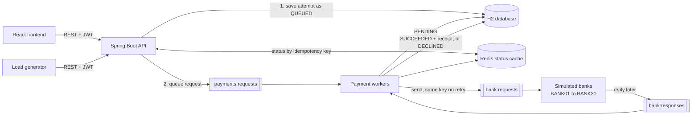

# Payment System

A learning project that simulates a payment gateway such as Stripe or Razorpay. It has a Java and Spring Boot backend, a Redis queue pipeline with 30 simulated banks, a React frontend, and a load generator. No real money or real card data should be used.

## Architecture



A payment request is accepted in a few milliseconds with `202 Accepted`. Workers then send it to the bank, and the bank replies later on a queue. The database is the source of truth; Redis holds the queues and a fast copy of each request's status.

| Part | Where | What it does |
| --- | --- | --- |
| API | `backend/.../controllers`, `services` | Merchant sign-up and login, payments, payment requests, receipts, and system statistics. |
| Queues | `backend/.../queue` | Three Redis streams with consumer groups: `payments:requests`, `bank:requests`, and `bank:responses`, plus `payments:dead-letters`. |
| Workers | `backend/.../workers`, `services/PaymentProcessor` | Handle queue messages, take over messages from workers that died, requeue lost requests, and retry the bank after a timeout. |
| Status cache | `backend/.../idempotency` | Redis hash per request, keyed by payment and idempotency key. A write carrying an older version is ignored. |
| Simulated banks | `backend/.../bank` | Stand in for the customers' banks, `BANK01` to `BANK30`. Each bank answers at its own speed (150 to 450 ms) and declines its own share of `RANDOM` requests (6% to 18%). A bank remembers every request key, so a retried request gets the same answer. |
| Frontend | `frontend/` | Create payments, pay with a chosen bank behaviour, retry with the same key, see the receipt, and watch the queues live. |
| Load generator | `loadtest/load-test.mjs` | Up to millions of customers paying thousands of merchants through all 30 banks, on several threads, with retries using the same key. Every total is checked against the backend, overall and per bank. |

See [docs/relationship-map.md](docs/relationship-map.md) for the entities, tables, DTOs, and status rules.

## Payment Request Flow

1. The merchant creates a payment (`POST /api/v1/payments`), which starts as `AWAITING_PAYMENT`.
2. When the customer presses Pay, the client generates an **idempotency key once** and sends `POST /api/v1/payments/{id}/attempts` with that key, a bank behaviour, and the customer's bank (for example `BANK07`; `BANK01` when omitted).
3. The API locks the payment row, saves a `QUEUED` attempt, commits, and only then queues the request and caches its status. It answers `202` with a `Location` header pointing to the status URL.
4. A payment worker marks the attempt `PENDING`, commits, and sends the request to the customer's bank.
5. The bank replies on `bank:responses`. A worker locks the payment, records `SUCCEEDED` with a **receipt** or `DECLINED`, commits, updates the Redis status, and acknowledges the message.
6. The client polls `GET /api/v1/payments/{id}/requests/{key}` until the status is final. It is served from Redis when possible and from H2 otherwise.

**Idempotency.** Every retry of a request must reuse its key. A retry returns the original attempt with `Idempotent-Replayed: true`, and never creates a second attempt, even when many retries arrive at once. The same key with a different bank behaviour or bank returns `409`. After a decline, the customer can pay again with a **new** key. Payment creation has its own `Idempotency-Key`.

**Receipts.** A receipt is created in the same database transaction that marks the payment `SUCCEEDED`, before the confirmation is sent. Unique database constraints allow only one receipt per payment and per attempt.

## Failure Handling

| What goes wrong | What happens |
| --- | --- |
| A worker dies holding a message | The message stays pending in its consumer group. After `reclaim-idle-timeout`, another worker claims and handles it. |
| A worker dies after receiving a bank reply | The reply stays pending on `bank:responses` and is applied by another worker, so the bank's answer is never lost. |
| The API crashes after saving but before queueing | The attempt is still `QUEUED` in the database and is requeued after `requeue-after`. |
| The bank does not reply | After `bank-reply-timeout`, the request is sent again with the same key. After `max-bank-requests`, the attempt is `FAILED` and the payment can be retried with a new key. |
| The bank replies twice, or a message is delivered twice | Status checks under a row lock make the second copy a no-op. |
| The bank approves after the attempt failed | The reply is kept on `payments:dead-letters` for reconciliation instead of being dropped. |
| A message keeps failing | After `max-deliveries`, it moves to `payments:dead-letters` so it cannot block the queue. |
| Redis is down | Every status is saved in H2 before Redis is touched, so nothing is lost. Requests are still accepted as `QUEUED` and status reads come from H2. After a Redis error the API skips Redis for `redis-retry-after`, so answers stay fast instead of waiting on timeouts. The backend also starts without Redis. Once Redis is back, workers resume and queued attempts are sent. |
| Redis comes back without its data | Each maintenance run recreates the consumer groups, and lost queue messages are requeued or resent from H2. |
| Redis lost the latest status update | A cached status that is not final is read again from H2 after `status-recheck-after`, so a client never sees an old status for longer than that. Final statuses never change, so they are always served from Redis. |

Messages are acknowledged only after their database transaction commits, so every step can safely run again.

## Run Locally

Requirements: JDK 25, Node.js 22 or later, and Docker (for Redis).

```powershell
# 1. Redis, with append-only persistence, bound to 127.0.0.1:6379
docker compose up -d redis

# 2. Backend on http://127.0.0.1:8080
$env:JAVA_HOME = 'C:\Program Files\Java\jdk-25'
Set-Location backend
.\mvnw.cmd spring-boot:run

# 3. Frontend on http://localhost:5173, in another terminal
Set-Location frontend
npm install
npm run dev
```

Open http://localhost:5173, create a merchant account, create a payment, and pay it with different bank behaviours. The **System** tab shows the queues and totals live.

| Bank behaviour | Result |
| --- | --- |
| `APPROVE` | Approved after the bank's reply time, 150 to 450 ms depending on the bank. |
| `DECLINE` | Declined with `insufficient_funds`. |
| `SLOW_APPROVE` | Approved after 1.5 to 4.5 seconds, depending on the bank. |
| `TIMEOUT_THEN_APPROVE` | The first request gets no reply; the retry with the same key is approved. |
| `DUPLICATE_REPLY` | Approved, and the bank sends the reply twice. |
| `NO_REPLY` | The bank never replies, so the attempt fails after the last retry. |
| `RANDOM` | The bank declines its own share, 6% to 18%. Of the rest, 5% are slow, 2% time out then approve, 1% get a duplicate reply, and the others approve. |

`GET /api/v1/simulator/banks` lists every bank with its reply time and decline rate.

## APIs

All `/api/v1` endpoints except registration and login need `Authorization: Bearer <token>`.

| Method | Endpoint | Purpose |
| --- | --- | --- |
| POST | `/auth/register` | Create a merchant account. |
| POST | `/auth/login` | Get a bearer token (valid for 15 minutes by default). |
| GET | `/merchants/me` | The signed-in merchant. |
| POST | `/payments` | Create a payment. Requires `Idempotency-Key`. |
| GET | `/payments` | Payment history. Optional `status`, `page`, and `size` (1 to 100). |
| GET | `/payments/{id}` | Payment details. |
| POST | `/payments/{id}/cancel` | Cancel a payment awaiting payment. |
| POST | `/payments/{id}/attempts` | Queue a payment request. Requires `Idempotency-Key` (8 to 64 letters, digits, `-` or `_`) and a `scenario`; `bank` is optional. Returns 202. |
| GET | `/payments/{id}/requests/{key}` | Status of a payment request by its idempotency key, including the bank that answered, from Redis when available. |
| GET | `/payments/{id}/attempts` | All attempts of a payment. |
| GET | `/payments/{id}/attempts/{attemptId}` | One attempt. |
| GET | `/payments/{id}/receipt` | The receipt of a succeeded payment. |
| GET | `/simulator/stats` | Queue lengths and pending counts, plus totals by status and attempts by bank. System-wide, for the simulation dashboard. |
| GET | `/simulator/banks` | The simulated banks with their reply times and decline rates. |

`GET /actuator/health` is public. Errors use the problem-detail format (`application/problem+json`) with 400, 401, 404, 409, or 500. Amounts are integers in paise, from 1 to 100,000,000; decimal amounts are rejected rather than truncated. Only `INR` is supported.

## Configuration

| Environment variable | Default | Purpose |
| --- | --- | --- |
| `SERVER_ADDRESS`, `SERVER_PORT` | `127.0.0.1`, `8080` | Where the backend listens. |
| `DB_URL` | `jdbc:h2:file:./data/payment-system;LOCK_TIMEOUT=10000` | Local H2 file under `backend/data/`. |
| `DB_POOL_SIZE` | `30` | Database connections. |
| `REDIS_HOST`, `REDIS_PORT` | `localhost`, `6379` | Redis for queues and the status cache. |
| `PAYMENT_WORKERS_ENABLED` | `true` | Run queue workers in this instance. |
| `PAYMENT_WORKER_COUNT` | `4` | Workers per queue in this instance. |
| `BANK_SIMULATOR_ENABLED` | `true` | Run the simulated banks in this instance. |
| `BANK_COUNT` | `30` | Number of simulated banks, `BANK01` upwards. |
| `JWT_SECRET` | Random per start in the local profile | HS256 signing secret, at least 32 characters. |
| `JWT_ACCESS_TOKEN_TTL` | `15m` | Token lifetime. |
| `CORS_ALLOWED_ORIGINS` | `http://localhost:3000,http://localhost:5173` | Browser origins allowed to call the API. |

Timings such as `app.processing.reclaim-idle-timeout`, `bank-reply-timeout`, and `max-bank-requests` are in [application.yml](backend/src/main/resources/application.yml). Several backend instances can share one Redis: each worker joins the same consumer groups, and Redis spreads the messages between them.

Passwords are hashed with PBKDF2, which has no 72-byte limit like BCrypt. Tokens are stateless; with the default random secret they stop working when the backend restarts.

## Tests

| Suite | Command | What it covers |
| --- | --- | --- |
| Backend unit | `.\mvnw.cmd test` in `backend` | Bank behaviour rules, queue message mapping, and the processor and request service with mocks, including that queueing happens only after commit. |
| Backend behaviour | same | Real Redis (Testcontainers), workers driven step by step: one attempt per key under concurrent retries, a worker dying mid-message, a lost queue message, bank timeouts, duplicate replies, poison messages, stale cache writes, cache misses, Redis restarting without its data, an outdated cached status, and routing to the customer's bank. Another suite starts the backend with Redis down and checks that requests are accepted and answered from H2. |
| Backend end to end | same | Real HTTP server, background workers, and Redis: a full journey with receipt, and concurrent merchants across every bank behaviour checked for consistency. |
| Backend controllers, models, repositories | same | Routes, security, validation, error responses, relationships, and constraints. |
| Frontend unit | `npm test` in `frontend` | Money parsing without floating point, polling, the API client, and components, including that Retry sends the same key. |
| Frontend end to end | `npm run test:e2e` in `frontend` | Playwright drives Chromium against the real backend: pay, retry with the same key, one receipt, decline then recover from a lost bank request. |

The backend suite needs Docker for its Redis containers. The Playwright tests need Redis running (`docker compose up -d redis`), the backend jar built (`.\mvnw.cmd package`), and Chromium installed once with `npx playwright install chromium`; they start the backend and frontend themselves.

## Load Testing

Start Redis and the backend, then run from the project root:

```powershell
node loadtest/load-test.mjs --merchants 1000 --customers 5000 --concurrency 200
```

The generator registers the merchants, then runs customer journeys concurrently on `--workers` threads (default 4), because one JavaScript thread tops out near 3,000 requests per second. Each customer pays from one of the banks; bigger banks have more customers. A journey creates a payment, generates a key once, sometimes retries the same request to check that it is replayed, waits for the final status, and checks that the customer's bank answered. After a decline it sometimes pays again with a new key.

Afterwards it waits for the queues to drain and compares what customers saw with what the backend stored during the run: new payments, attempts by status, receipts against succeeded payments, and every count for every bank. Nothing may be left `QUEUED` or `PENDING`, and no message may go to dead letters. A random sample of payments (`--verify-sample`, default 20,000) is then checked in full: one attempt per key, all sent to the customer's bank, and a receipt if and only if the payment succeeded. It exits with an error if any check fails.

Options: `--base-url`, `--merchants`, `--customers`, `--banks`, `--workers`, `--concurrency` (journeys in flight across all threads), `--signup-concurrency`, `--duplicate-rate`, `--new-key-retry-rate`, `--scenario` (default `RANDOM`), `--poll-interval`, `--journey-timeout`, `--verify-sample`, and `--progress-interval` (seconds).

### A million customers

For a run this size, use a separate backend with its own H2 file and a throwaway Redis, so the development data stays untouched, and a token lifetime longer than the run:

```powershell
docker run -d --rm --name paymentsystem-loadtest-redis -p 127.0.0.1:6380:6379 redis:7.4-alpine redis-server --save "" --appendonly no

# in backend, after .\mvnw.cmd package
java -Xmx5g -jar target\payment-system-0.0.1-SNAPSHOT.jar --server.port=8090 --spring.data.redis.port=6380 `
  "--spring.datasource.url=jdbc:h2:file:./data/loadtest-1m/payments;LOCK_TIMEOUT=10000;CACHE_SIZE=2097152" `
  --spring.datasource.hikari.maximum-pool-size=64 --app.processing.worker-count=8 `
  --app.processing.status-ttl=15m --app.bank.memory-ttl=15m --app.security.jwt.access-token-ttl=3h `
  --server.tomcat.max-keep-alive-requests=-1 --logging.level.root=WARN

# in another terminal, from the project root
node loadtest/load-test.mjs --base-url http://127.0.0.1:8090 --merchants 10000 --customers 1000000 --banks 30 --workers 4 --concurrency 2000 --signup-concurrency 40
```

Result on the development machine (Intel i7-14700K, one backend instance, H2 file database), 2026-09-27:

| Measure | Result |
| --- | --- |
| Scale | 10,000 merchants, 1,000,000 customers, 30 banks, 2,000 journeys in flight |
| Customer payments | 1,000,000 in 22.6 minutes, 737 customers per second |
| HTTP requests | 12.4 million in total, about 9,100 per second during the payments |
| Payment requests | 1,059,659: 932,700 succeeded, 126,959 declined, 0 failed |
| Create payment | median 15 ms, 99th percentile 89 ms |
| Submit payment request | median 19 ms, 99th percentile 235 ms |
| Status poll (10 million) | median 17 ms, 99th percentile 174 ms |
| Request to final status | median 2.2 s, 95th percentile 4.4 s; the slowest are lost bank requests retried after the 8-second timeout |
| Per bank | each bank's declined share matched its decline rate within 0.4 points, and faster banks finished sooner |
| Client retries | 663 create-payment calls hit a connection error and succeeded when sent again with the same idempotency key |
| Consistency | 0 errors and 0 violations: every total matched the backend overall and per bank, 932,700 receipts for 932,700 succeeded payments, queues empty, no dead letters, and all 20,000 sampled payments correct |
| Resources | backend peak 5.5 GB, Redis peak 965 MB, H2 file 2.7 GB |

The first attempt at this scale stalled at about 850,000 payments. Random UUID keys scatter inserts and lookups across every index page, so once the 2.6 GB database outgrew H2's cache, almost every operation read from disk, and on Windows those reads queue on one file lock. Primary keys are now time-ordered UUIDv7, so new rows land at the end of each index and only recent pages need to stay cached.

Merchant sign-up takes about 200 ms each because PBKDF2 hashing is deliberately slow.

## Limitations

- H2 suits learning, not production. A real deployment needs PostgreSQL, versioned migrations, and database-specific tests.
- The simulated bank holds scheduled replies in memory. If the backend stops, those replies are lost and the payment side retries with the same key, as it would with a real bank that never answered.
- Dead letters are kept for investigation, but there is no reconciliation tool for them yet. They live only in Redis, so losing Redis data also loses them, including bank approvals that arrived after an attempt failed.
- There is no rate limiting, refresh token, refund, settlement, or webhook support yet.
