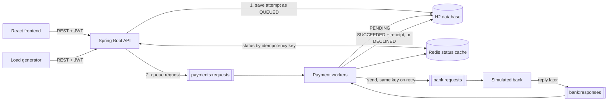

# Payment System

A learning project that simulates a payment gateway such as Stripe or Razorpay. It has a Java and Spring Boot backend, a Redis queue pipeline with a simulated bank, a React frontend, and a load generator. No real money or real card data should be used.

## Architecture



A payment request is accepted in a few milliseconds with `202 Accepted`. Workers then send it to the bank, and the bank replies later on a queue. The database is the source of truth; Redis holds the queues and a fast copy of each request's status.

| Part | Where | What it does |
| --- | --- | --- |
| API | `backend/.../controllers`, `services` | Merchant sign-up and login, payments, payment requests, receipts, and system statistics. |
| Queues | `backend/.../queue` | Three Redis streams with consumer groups: `payments:requests`, `bank:requests`, and `bank:responses`, plus `payments:dead-letters`. |
| Workers | `backend/.../workers`, `services/PaymentProcessor` | Handle queue messages, take over messages from workers that died, requeue lost requests, and retry the bank after a timeout. |
| Status cache | `backend/.../idempotency` | Redis hash per request, keyed by payment and idempotency key. A write carrying an older version is ignored. |
| Simulated bank | `backend/.../bank` | Stands in for an external bank. Remembers every request key, so a retried request gets the same answer. |
| Frontend | `frontend/` | Create payments, pay with a chosen bank behaviour, retry with the same key, see the receipt, and watch the queues live. |
| Load generator | `loadtest/load-test.mjs` | Thousands of merchants and customers, retries with the same key, and a consistency check of every payment. |

See [docs/relationship-map.md](docs/relationship-map.md) for the entities, tables, DTOs, and status rules.

## Payment Request Flow

1. The merchant creates a payment (`POST /api/v1/payments`), which starts as `AWAITING_PAYMENT`.
2. When the customer presses Pay, the client generates an **idempotency key once** and sends `POST /api/v1/payments/{id}/attempts` with that key and a bank behaviour.
3. The API locks the payment row, saves a `QUEUED` attempt, commits, and only then queues the request and caches its status. It answers `202` with a `Location` header pointing to the status URL.
4. A payment worker marks the attempt `PENDING`, commits, and sends the request to the bank.
5. The bank replies on `bank:responses`. A worker locks the payment, records `SUCCEEDED` with a **receipt** or `DECLINED`, commits, updates the Redis status, and acknowledges the message.
6. The client polls `GET /api/v1/payments/{id}/requests/{key}`, which is served from Redis, until the status is final.

**Idempotency.** Every retry of a request must reuse its key. A retry returns the original attempt with `Idempotent-Replayed: true`, and never creates a second attempt, even when many retries arrive at once. The same key with a different bank behaviour returns `409`. After a decline, the customer can pay again with a **new** key. Payment creation has its own `Idempotency-Key`.

**Receipts.** A receipt is created in the same database transaction that marks the payment `SUCCEEDED`, before the confirmation is sent. Unique database constraints allow only one receipt per payment and per attempt.

## Failure Handling

| What goes wrong | What happens |
| --- | --- |
| A worker dies holding a message | The message stays pending in its consumer group. After `reclaim-idle-timeout`, another worker claims and handles it. |
| A worker dies after receiving a bank reply | The reply stays pending on `bank:responses` and is applied by another worker, so the bank's answer is never lost. |
| The API crashes after saving but before queueing | The attempt is still `QUEUED` in the database and is requeued after `requeue-after`. |
| The bank does not reply | After `bank-reply-timeout`, the request is sent again with the same key. After `max-bank-requests`, the attempt is `FAILED` and the payment can be retried with a new key. |
| The bank replies twice, or a message is delivered twice | Status checks under a row lock make the second copy a no-op. |
| The bank approves after the attempt failed | The reply is kept on `payments:dead-letters` for reconciliation instead of being dropped. |
| A message keeps failing | After `max-deliveries`, it moves to `payments:dead-letters` so it cannot block the queue. |
| Redis is briefly unavailable | Requests are still saved; status reads fall back to the database, and queued attempts are sent once Redis is back. |

Messages are acknowledged only after their database transaction commits, so every step can safely run again.

## Run Locally

Requirements: JDK 25, Node.js 22 or later, and Docker (for Redis).

```powershell
# 1. Redis, with append-only persistence, bound to 127.0.0.1:6379
docker compose up -d redis

# 2. Backend on http://127.0.0.1:8080
$env:JAVA_HOME = 'C:\Program Files\Java\jdk-25'
Set-Location backend
.\mvnw.cmd spring-boot:run

# 3. Frontend on http://localhost:5173, in another terminal
Set-Location frontend
npm install
npm run dev
```

Open http://localhost:5173, create a merchant account, create a payment, and pay it with different bank behaviours. The **System** tab shows the queues and totals live.

| Bank behaviour | Result |
| --- | --- |
| `APPROVE` | Approved after about 300 ms. |
| `DECLINE` | Declined with `insufficient_funds`. |
| `SLOW_APPROVE` | Approved after about 3 seconds. |
| `TIMEOUT_THEN_APPROVE` | The first request gets no reply; the retry with the same key is approved. |
| `DUPLICATE_REPLY` | Approved, and the bank sends the reply twice. |
| `NO_REPLY` | The bank never replies, so the attempt fails after the last retry. |
| `RANDOM` | 80% approve, 12% decline, 5% slow, 2% timeout then approve, 1% duplicate reply. |

## APIs

All `/api/v1` endpoints except registration and login need `Authorization: Bearer <token>`.

| Method | Endpoint | Purpose |
| --- | --- | --- |
| POST | `/auth/register` | Create a merchant account. |
| POST | `/auth/login` | Get a bearer token (valid for 15 minutes by default). |
| GET | `/merchants/me` | The signed-in merchant. |
| POST | `/payments` | Create a payment. Requires `Idempotency-Key`. |
| GET | `/payments` | Payment history. Optional `status`, `page`, and `size` (1 to 100). |
| GET | `/payments/{id}` | Payment details. |
| POST | `/payments/{id}/cancel` | Cancel a payment awaiting payment. |
| POST | `/payments/{id}/attempts` | Queue a payment request. Requires `Idempotency-Key` (8 to 64 letters, digits, `-` or `_`) and a `scenario`. Returns 202. |
| GET | `/payments/{id}/requests/{key}` | Status of a payment request by its idempotency key, from Redis when available. |
| GET | `/payments/{id}/attempts` | All attempts of a payment. |
| GET | `/payments/{id}/attempts/{attemptId}` | One attempt. |
| GET | `/payments/{id}/receipt` | The receipt of a succeeded payment. |
| GET | `/simulator/stats` | Queue lengths and pending counts, plus totals by status. System-wide, for the simulation dashboard. |

`GET /actuator/health` is public. Errors use the problem-detail format (`application/problem+json`) with 400, 401, 404, 409, or 500. Amounts are integers in paise, from 1 to 100,000,000; decimal amounts are rejected rather than truncated. Only `INR` is supported.

## Configuration

| Environment variable | Default | Purpose |
| --- | --- | --- |
| `SERVER_ADDRESS`, `SERVER_PORT` | `127.0.0.1`, `8080` | Where the backend listens. |
| `DB_URL` | `jdbc:h2:file:./data/payment-system;LOCK_TIMEOUT=10000` | Local H2 file under `backend/data/`. |
| `DB_POOL_SIZE` | `30` | Database connections. |
| `REDIS_HOST`, `REDIS_PORT` | `localhost`, `6379` | Redis for queues and the status cache. |
| `PAYMENT_WORKERS_ENABLED` | `true` | Run queue workers in this instance. |
| `PAYMENT_WORKER_COUNT` | `4` | Workers per queue in this instance. |
| `BANK_SIMULATOR_ENABLED` | `true` | Run the simulated bank in this instance. |
| `JWT_SECRET` | Random per start in the local profile | HS256 signing secret, at least 32 characters. |
| `JWT_ACCESS_TOKEN_TTL` | `15m` | Token lifetime. |
| `CORS_ALLOWED_ORIGINS` | `http://localhost:3000,http://localhost:5173` | Browser origins allowed to call the API. |

Timings such as `app.processing.reclaim-idle-timeout`, `bank-reply-timeout`, and `max-bank-requests` are in [application.yml](backend/src/main/resources/application.yml). Several backend instances can share one Redis: each worker joins the same consumer groups, and Redis spreads the messages between them.

Passwords are hashed with PBKDF2, which has no 72-byte limit like BCrypt. Tokens are stateless; with the default random secret they stop working when the backend restarts.

## Tests

| Suite | Command | What it covers |
| --- | --- | --- |
| Backend unit | `.\mvnw.cmd test` in `backend` | Bank behaviour rules, queue message mapping, and the processor and request service with mocks, including that queueing happens only after commit. |
| Backend behaviour | same | Real Redis (Testcontainers), workers driven step by step: one attempt per key under concurrent retries, a worker dying mid-message, a lost queue message, bank timeouts, duplicate replies, poison messages, stale cache writes, and cache misses. |
| Backend end to end | same | Real HTTP server, background workers, and Redis: a full journey with receipt, and concurrent merchants across every bank behaviour checked for consistency. |
| Backend controllers, models, repositories | same | Routes, security, validation, error responses, relationships, and constraints. |
| Frontend unit | `npm test` in `frontend` | Money parsing without floating point, polling, the API client, and components, including that Retry sends the same key. |
| Frontend end to end | `npm run test:e2e` in `frontend` | Playwright drives Chromium against the real backend: pay, retry with the same key, one receipt, decline then recover from a lost bank request. |

The backend suite needs Docker for its Redis containers. The Playwright tests need Redis running (`docker compose up -d redis`), the backend jar built (`.\mvnw.cmd package`), and Chromium installed once with `npx playwright install chromium`; they start the backend and frontend themselves.

## Load Testing

Start Redis and the backend, then run from the project root:

```powershell
node loadtest/load-test.mjs --merchants 1000 --customers 5000 --concurrency 200
```

The generator registers the merchants, then runs each customer journey concurrently. A journey creates a payment, generates a key once, sometimes retries the same request to check that it is replayed, waits for the final status, and sometimes pays again with a new key after a decline. Afterwards it checks every payment: each key produced exactly one attempt, nothing is left unfinished, and a payment has a receipt if and only if it succeeded. It exits with an error if any check fails.

Options: `--base-url`, `--merchants`, `--customers`, `--concurrency`, `--signup-concurrency`, `--duplicate-rate`, `--new-key-retry-rate`, `--scenario` (default `RANDOM`), `--poll-interval`, and `--journey-timeout`.

A run on the development machine (one backend instance, H2 in memory) with 1,000 merchants and 5,000 customers:

| Measure | Result |
| --- | --- |
| HTTP requests | 50,577 in 49.7 seconds, about 1,000 per second |
| Payment request submit | median 4 ms, 99th percentile 287 ms |
| Status poll | median 3 ms, 99th percentile 52 ms |
| Request to final status | median 0.5 s; the slowest are lost bank requests retried after the 8-second timeout |
| Errors and consistency violations | 0 |
| Queues afterwards | all empty, none pending |

Merchant sign-up takes about 250 ms each because PBKDF2 hashing is deliberately slow.

## Limitations

- H2 suits learning, not production. A real deployment needs PostgreSQL, versioned migrations, and database-specific tests.
- The simulated bank holds scheduled replies in memory. If the backend stops, those replies are lost and the payment side retries with the same key, as it would with a real bank that never answered.
- Dead letters are kept for investigation, but there is no reconciliation tool for them yet.
- There is no rate limiting, refresh token, refund, settlement, or webhook support yet.
