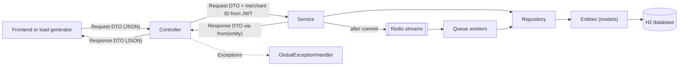
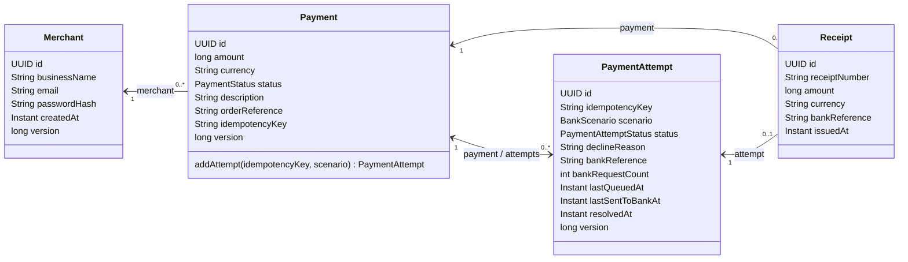
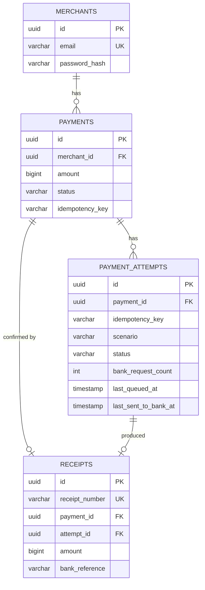
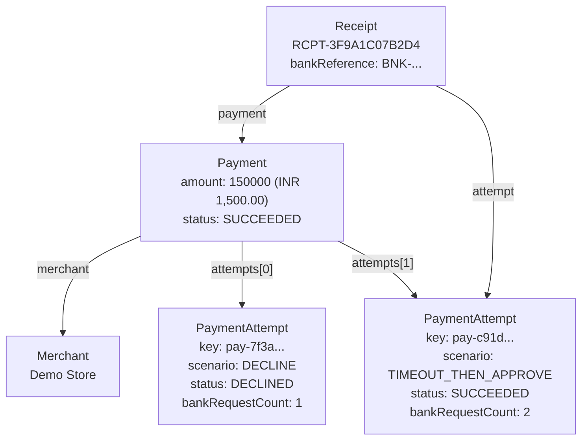
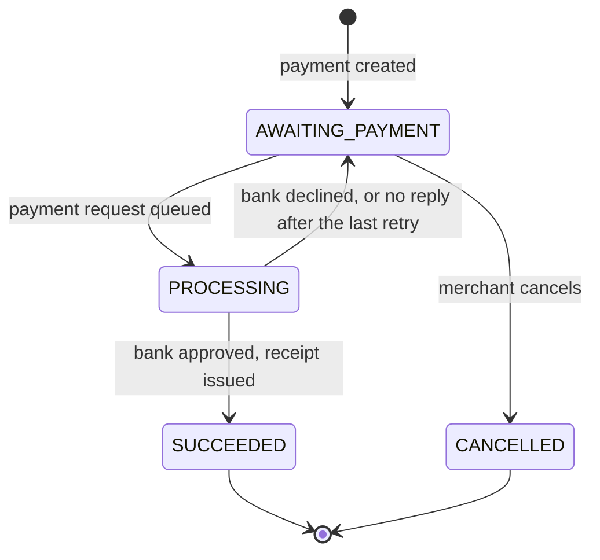
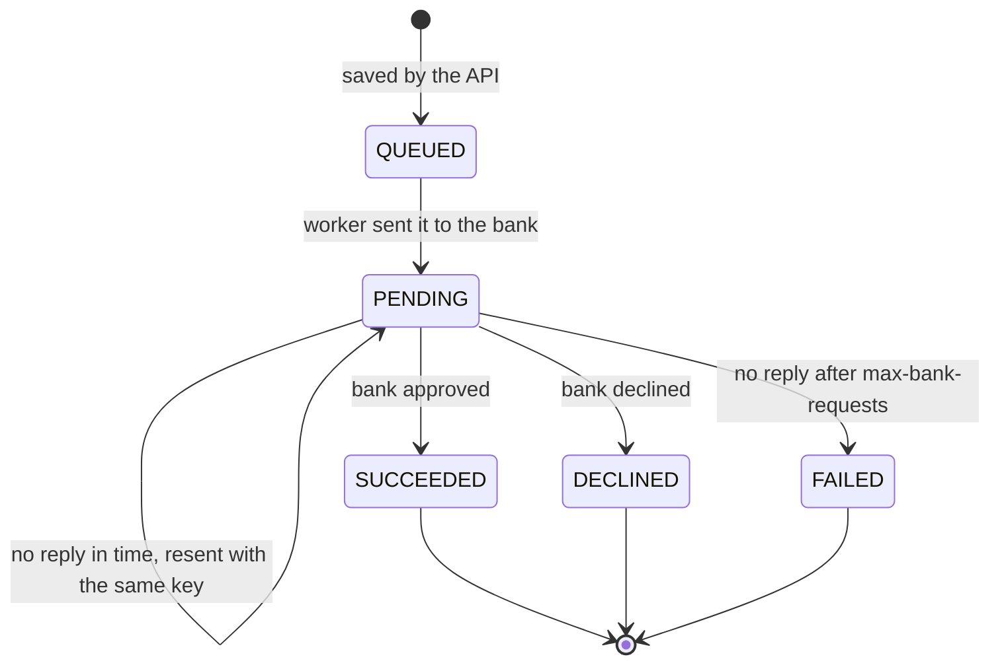

# Relationship Map

How the backend's classes, tables, and objects relate: the JPA entities, the tables they create, the DTOs returned by the API, the queue messages, and the status rules.

## Layers

- Controllers never receive or return entities. They accept request DTOs and return response DTOs.
- Services own business rules, lock the payment row before changing it, and send queue messages only after the database transaction commits.
- Workers are the same services driven by queue messages instead of HTTP requests.

## Entity Relationships

| Relationship | Cardinality | Java mapping | Owning side |
| --- | --- | --- | --- |
| Merchant to Payment | One merchant, many payments | `Payment.merchant`, `@ManyToOne` | `Payment` (`merchant_id`) |
| Payment to PaymentAttempt | One payment, many attempts | `PaymentAttempt.payment`, `@ManyToOne`; `Payment.attempts`, `@OneToMany(mappedBy)` | `PaymentAttempt` (`payment_id`) |
| Payment to Receipt | One payment, at most one receipt | `Receipt.payment`, `@OneToOne` | `Receipt` (unique `payment_id`) |
| PaymentAttempt to Receipt | One attempt, at most one receipt | `Receipt.attempt`, `@OneToOne` | `Receipt` (unique `attempt_id`) |

- **Merchant has no list of payments.** A merchant can have thousands, so `PaymentRepository.findByMerchantId` loads them page by page.
- **Payment holds its attempts.** Attempts are created only through `Payment.addAttempt(...)`, which starts them as `QUEUED`; `getAttempts()` is read-only.
- **Receipts point at both the payment and the attempt.** The unique join columns mean a payment can only ever be confirmed once.
- **Relationships load lazily.** Reading an attempt does not load its payment until the payment is used.

## Database Tables

| Table | Rule | Purpose |
| --- | --- | --- |
| `merchants` | Unique `email` | One account per email address. |
| `payments` | Unique `merchant_id` + `idempotency_key` | A retried create request cannot make a second payment. |
| `payment_attempts` | Unique `payment_id` + `idempotency_key` | A retried payment request cannot make a second attempt. |
| `payment_attempts` | Index on `status` | Recovery jobs find stale `QUEUED` and `PENDING` attempts quickly. |
| `receipts` | Unique `payment_id`, `attempt_id`, and `receipt_number` | At most one receipt per payment and per attempt. |

Every entity has a `version` column for optimistic locking, and every status change also takes a row lock on the payment, so changes to one payment run one at a time.

## Object Example

A merchant creates a payment. The first request is declined; the second request's first bank message is lost, the retry with the same key is approved, and a receipt is issued.

## Status Rules

A payment accepts one payment request at a time. Each request is a `PaymentAttempt`:

`SUCCEEDED`, `DECLINED`, and `FAILED` are final. A reply for a final attempt changes nothing.

## Queue Messages

| Stream | Consumer group | Message | Written by | Read by |
| --- | --- | --- | --- | --- |
| `payments:requests` | `payment-workers` | `PaymentRequestMessage` (attempt, payment, key) | API, recovery job | Payment workers |
| `bank:requests` | `bank-simulator` | `BankRequest` (bank key, amount, scenario) | Payment workers | Simulated bank |
| `bank:responses` | `payment-workers` | `BankResponse` (bank key, outcome, bank reference) | Simulated bank | Payment workers |
| `payments:dead-letters` | none | Original fields plus source stream and reason | Workers | People investigating |

The bank key is `{paymentId}:{idempotencyKey}`, identical on every retry, so the bank can recognise a repeated request.

## Entity To DTO Mapping

| Entity | Response DTO | Fields left out or added |
| --- | --- | --- |
| `Merchant` | `MerchantResponse` | Leaves out `passwordHash` and `version`. |
| `Payment` | `PaymentResponse` | Leaves out `merchant`, `idempotencyKey`, `attempts`, and `version`. |
| `PaymentAttempt` | `PaymentAttemptResponse` | Parent becomes `paymentId`; adds `receiptNumber`; leaves out queue timestamps and `version`. |
| `Receipt` | `ReceiptResponse` | Parents become `paymentId` and `attemptId`. |
| Redis status | `PaymentRequestStatusResponse` | Adds `source`: `cache` or `database`. |

| Request DTO | Used by | Creates or changes |
| --- | --- | --- |
| `RegisterRequest` | `AuthService.register` | New `Merchant` with a hashed password. |
| `LoginRequest` | `AuthService.login` | Returns an `AuthResponse` token. |
| `CreatePaymentRequest` + `Idempotency-Key` | `PaymentService.createPayment` | New `Payment`. |
| `CreatePaymentAttemptRequest` + `Idempotency-Key` | `PaymentRequestService.submit` | New `QUEUED` `PaymentAttempt`; the payment becomes `PROCESSING`. |

`PageResponse<T>` wraps paged lists, and `SystemStatsResponse` reports queue lengths, pending counts, and totals.

## Error Responses

All errors use the problem-detail JSON format (`application/problem+json`).

| Cause | Status |
| --- | --- |
| Invalid body, header, path, or query value; unsupported currency (`InvalidRequestException`) | 400 |
| Missing, expired, or invalid token; wrong credentials (same message for unknown email and wrong password) | 401 |
| `ResourceNotFoundException`, including another merchant's payment | 404 |
| `ConflictException`, a duplicate unique value, or a concurrent update that lost | 409 |
| Any other exception, logged without details in the response | 500 |
