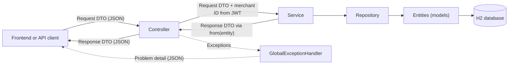
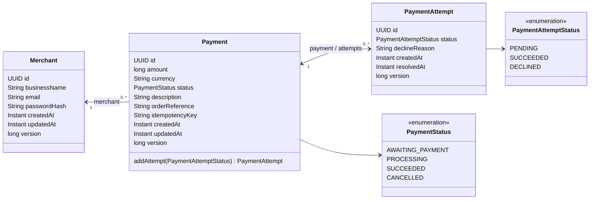
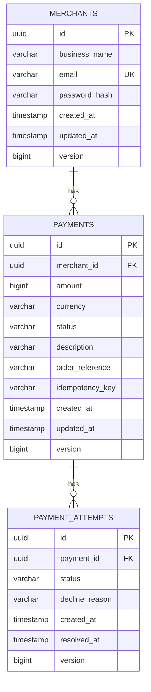
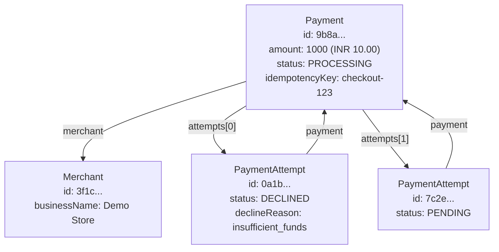
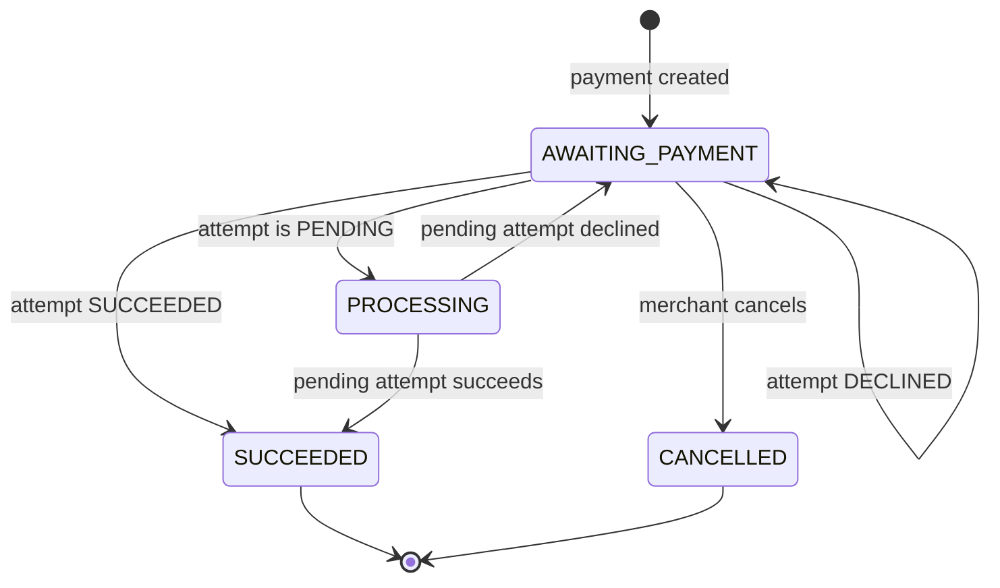

# Relationship Map

This document explains how the backend's classes and objects relate to each other. It covers the JPA entities, the database tables they create, the DTOs returned by the API, and the error responses.

## Layers



- Controllers never receive or return entities. They accept request DTOs and return response DTOs.
- Services own business rules and convert entities to DTOs with the static `from(...)` methods.

## Repositories

| Repository | Entity | Queries |
| --- | --- | --- |
| `MerchantRepository` | `Merchant` | `findByEmail`, `existsByEmail` |
| `PaymentRepository` | `Payment` | `findByIdAndMerchantId`, `findByMerchantIdAndIdempotencyKey`, `findByMerchantId` (paged), `findByMerchantIdAndStatus` (paged) |
| `PaymentAttemptRepository` | `PaymentAttempt` | `findByPaymentIdOrderByCreatedAtAsc`, `findByIdAndPaymentIdAndPaymentMerchantId` |

Spring Data generates each query from its method name. For example, `findByIdAndMerchantId(id, merchantId)` finds the payment with that ID whose `merchant.id` matches. Each repository also inherits standard methods such as `save` and `findById` from `JpaRepository`.

- **Scope by merchant.** Merchant requests should use the merchant-scoped methods, not the inherited `findById`. A payment owned by another merchant then comes back empty and is reported as 404.
- **Normalize emails.** Email lookups are exact, so services must store and search lowercase emails.
- **Save new attempts directly.** After calling `payment.addAttempt(...)` on a payment already loaded in the transaction, save the attempt with `paymentAttemptRepository.save(attempt)` or let the transaction commit. Calling `paymentRepository.save(payment)` merges instead, which stores a copy of the new attempt and leaves the original object without an ID.

## Entity Relationships



| Relationship | Cardinality | Java mapping | Owning side | Direction |
| --- | --- | --- | --- | --- |
| Merchant to Payment | One merchant, many payments | `Payment.merchant` with `@ManyToOne` | `Payment` (`merchant_id` column) | Payment to Merchant only |
| Payment to PaymentAttempt | One payment, many attempts | `PaymentAttempt.payment` with `@ManyToOne`; `Payment.attempts` with `@OneToMany(mappedBy = "payment")` | `PaymentAttempt` (`payment_id` column) | Both directions |

Why the directions differ:

- **Merchant does not hold a list of payments.** A merchant can accumulate thousands of payments, so loading them through a collection would be slow and easy to misuse. `PaymentRepository.findByMerchantId` loads them page by page instead.
- **Payment holds its attempts.** Attempts belong to exactly one payment and are few, so the payment manages them as one unit. `CascadeType.ALL` saves new attempts when their payment is saved.
- **Attempts are created only through `Payment.addAttempt(...)`.** The attempt constructor is package-private, so code cannot create an attempt without updating both sides of the relationship. `getAttempts()` returns a read-only list for the same reason.
- **Relationships load lazily.** Reading a payment does not load its merchant until the merchant is used.

## Database Tables



Constraints and indexes:

| Table | Rule | Purpose |
| --- | --- | --- |
| `merchants` | Unique `email` | One account per email address. |
| `payments` | Unique `merchant_id` + `idempotency_key` | A retried create request cannot make a second payment for the same merchant. Different merchants may use the same key. |
| `payments` | Index on `merchant_id`, `created_at` | Fast, newest-first transaction history per merchant. |
| `payment_attempts` | Index on `payment_id` | Fast lookup of a payment's attempts. |

Every entity has a `version` column for optimistic locking. If two requests update the same payment at the same time, the second save fails instead of silently overwriting the first.

## Object Example

One merchant creates a payment. The customer's first attempt is declined, and the second attempt is waiting for the processor.



The same objects as table rows:

| Table | Row |
| --- | --- |
| `merchants` | `id = 3f1c...`, `email = merchant@example.com` |
| `payments` | `id = 9b8a...`, `merchant_id = 3f1c...`, `amount = 1000`, `status = PROCESSING` |
| `payment_attempts` | `id = 0a1b...`, `payment_id = 9b8a...`, `status = DECLINED` |
| `payment_attempts` | `id = 7c2e...`, `payment_id = 9b8a...`, `status = PENDING` |

The foreign keys point from child to parent: attempts store their `payment_id`, and payments store their `merchant_id`.

## Status Rules

A payment can have many attempts, but at most one successful attempt.



These transitions describe the intended rules for the service implementations. The entities store statuses but do not enforce transitions yet.

## Entity To DTO Mapping

| Entity | Response DTO | Mapping | Fields left out |
| --- | --- | --- | --- |
| `Merchant` | `MerchantResponse` | `MerchantResponse.from(merchant)` | `passwordHash`, `updatedAt`, `version` |
| `Payment` | `PaymentResponse` | `PaymentResponse.from(payment)` | `merchant`, `idempotencyKey`, `attempts`, `version` |
| `PaymentAttempt` | `PaymentAttemptResponse` | `PaymentAttemptResponse.from(attempt)` | `version`; the parent payment becomes `paymentId` |

Request DTOs flow into services:

| Request DTO | Used by | Creates or changes |
| --- | --- | --- |
| `RegisterRequest` | `AuthService.register` | New `Merchant`; the password is hashed, never stored as plain text. |
| `LoginRequest` | `AuthService.login` | Nothing; returns an `AuthResponse` token. |
| `CreatePaymentRequest` + `Idempotency-Key` header | `PaymentService.createPayment` | New `Payment` owned by the signed-in merchant. |
| `SimulatedAttemptRequest` | `SimulatorService.simulateAttempt` | New `PaymentAttempt`, plus a payment status change. |

`PageResponse<T>` wraps lists, such as the payment history, with paging information.

Returning DTOs instead of entities keeps secrets such as password hashes out of responses, prevents lazy relationships from loading during JSON serialization, and lets the database design change without breaking the API.

## Error Responses

All errors use the standard problem-detail JSON format (`application/problem+json`):

```json
{
  "type": "about:blank",
  "title": "Resource not found",
  "status": 404,
  "detail": "Payment not found",
  "instance": "/api/v1/payments/9b8a7c6d-5e4f-4a3b-8c2d-1e0f9a8b7c6d"
}
```

| Cause | Status | Where it is handled |
| --- | --- | --- |
| Invalid body, header, path, or query value | 400 | Spring's built-in handlers, through `GlobalExceptionHandler` |
| Missing, expired, or invalid token | 401 | Spring Security, before the controller runs |
| `InvalidCredentialsException` | 401 | `GlobalExceptionHandler`; the same message for an unknown email and a wrong password |
| `ResourceNotFoundException` | 404 | `GlobalExceptionHandler` |
| `ConflictException` | 409 | `GlobalExceptionHandler`, for example when cancelling a succeeded payment |
| `DataIntegrityViolationException` | 409 | `GlobalExceptionHandler`, for example a duplicate email saved at the same moment by two requests |
| `ResponseStatusException` | Its own status | Spring's built-in handler; the service stubs use this for 501 |
| Any other exception | 500 | `GlobalExceptionHandler`; logs the error and returns a generic message without internal details |

Payments owned by another merchant should be reported as not found, not forbidden, so that the API does not reveal whether a payment ID exists.
